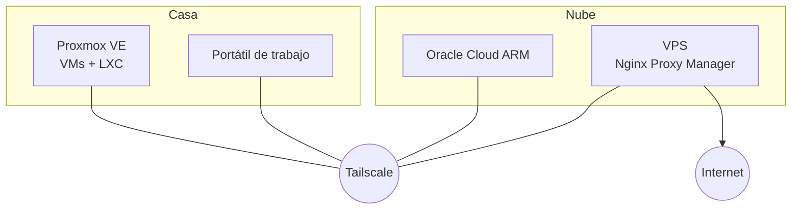

  
  
  
  

  

Técnico de sistemas y redes en Sevilla. Estudio ASIR y el Máster en Ciberseguridad e IA de Evolve, y el resto del tiempo lo paso montando y rompiendo cosas en mi homelab.

Me interesa sobre todo la parte defensiva: saber qué pasa en una red, detectar lo que no debería estar ahí y automatizar lo repetitivo para no tener que hacerlo a mano dos veces.

> **Busco** prácticas o un puesto a media jornada / por proyecto en sistemas, redes o ciberseguridad, compatible con los estudios.

### Ahora mismo

- Desarrollando **PHANTOM**, un entorno de honeypots con detección de amenazas apoyada en IA (aún privado).
- Cursando el Máster en Ciberseguridad e IA (Evolve) junto con ASIR.

---

### Proyectos

  
  
  
  

También están mis [apuntes de ASIR](https://github.com/antonio101105/ASIR), por si le sirven a alguien.

---

### Homelab

Lo uso para practicar lo que luego me piden en clase o en el trabajo.

- **Proxmox VE** como servidor central (máquinas virtuales y contenedores LXC)
- **Oracle Cloud** (ARM) para servicios expuestos
- **Tailscale** para unir todo sin abrir puertos
- VPS propios para despliegues web, con Nginx Proxy Manager

---

### Con qué trabajo

  

- **Sistemas:** Windows Server, Active Directory y GPOs, Linux, Proxmox VE
- **Redes:** routers y switches Cisco, firewalls, VPN
- **Scripting:** Python, Bash, PowerShell. También C++ y SQL
- **Web:** WordPress, Moodle, Drupal
- **Hardware:** montaje, mantenimiento y diagnóstico

### Certificaciones

  
  
  
  

